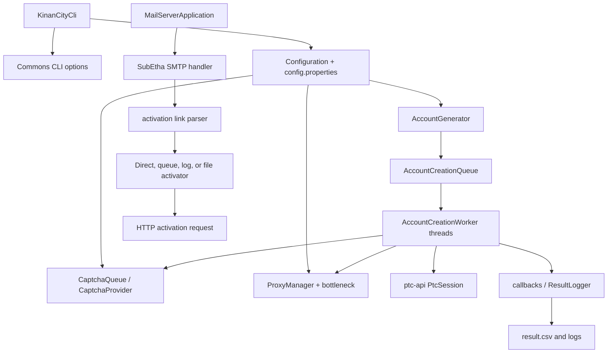

# KinanCity build notes

## Environment

- Checkout: `develop`, commit `d5ff6268b2e1530f62be52351fa30f3d3d205b03`.
- OS: Ubuntu 24.04.5 LTS (Noble), amd64.
- Maven: Apache Maven 3.9.16.
- Installed JDK: Microsoft OpenJDK 25.0.4.1 (Java 21.0.12 is also installed).
- Java 8 is not installed. The POM targets Java 8 with `maven.compiler.source/target` (`1.8`).

The build uses a repository-local cache because the default `/home/codespace/.m2` is not writable:

```sh
mvn -B -Dmaven.repo.local=/tmp/kinancity-m2 -Dmaven.compiler.proc=full clean package
```

## Build results

The unmodified build first failed during model resolution because the CAPTCHA server parent uses Spring Boot 2.4.0 and the environment could not resolve `jcenter.bintray.com`. With network access, compilation then reached `kinancity-utils` but Lombok 1.18.24 did not expose generated accessors under javac 25. The minimal compatibility changes in the root POM are:

1. Lombok `1.18.24` -> `1.18.42`.
2. Jackson databind management range `[2.9.10.5,)` -> pinned `2.13.3`; the unbounded range caused Maven to enumerate current Jackson metadata and made the build non-reproducible.

After these changes, every reactor module except `kinancity-captcha-server` compiled. The server fails in its own source with missing Lombok-generated `log` fields and DTO constructors/accessors (`CaptchaController`, `SolvingService`, `SolvingController`, `CaptchaJob`, and `JobStats`). This is a source/Lombok compatibility defect in that module, not a dependency-resolution failure. Core and all provider modules reached compilation; tests that ran were passing or explicitly skipped. No registration or CAPTCHA request was run.

The reactor modules declared by the root POM are: core, mail, ptc-api, utils, captcha-ImageTypers, captcha-api, captcha-2captcha, captcha-AntiCaptcha, captcha-server, captcha-client, captcha-capsolver, captcha-deathbycaptcha, and captcha-2captchaBasic.

## Architecture and execution flow



`KinanCityCli.main` parses Commons CLI options, loads `Configuration`, selects a single, sequence, CSV, or interactive generator, then starts `PtcAccountCreator`. The creator queues `AccountCreation` objects and starts worker threads. Each worker validates locally, obtains a proxy slot, performs the PTC session, requests a CAPTCHA through the provider queue, submits the creation request, and routes success, fatal errors, or retryable technical errors to callbacks. Results are logged to CSV and SLF4J/logback.

`KinanCity-core` owns orchestration, generators, workers, proxy policies, and result handling. `ptc-api` implements the PTC HTTP/session protocol. `KinanCity-utils` supplies throttling queues. `KinanCity-captcha-api` defines requests, queues, and provider abstractions; provider modules adapt 2captcha, AntiCaptcha, ImageTypers, Capsolver, DeathByCaptcha, and a local client. `KinanCity-captcha-server` exposes a Spring Boot local solving API; `captcha-client` adapts the core API to it. `KinanCity-mail` runs an SMTP server, extracts links from accepted Pokémon mail, and activates directly, queues, logs, or replays links from files.

## Input formats and safe tests

Sequence CLI syntax is `-m <base email> -f <pattern containing *> -p <password> -c <count> [-s <start>]`; `-u` selects a single username and `-a <file>` selects CSV. Source defaults the sequence start to `0`, while the README examples describe `1`; source behavior is authoritative. A pattern must contain one contiguous `*` group and has a numeric width limit. CSV uses semicolons and a first header line beginning with `#`; required fields are `username`, `password`, and `email`, with optional `dob` and `country`. The reader does not reject duplicate rows, extra fields, malformed dates, or short rows; missing values become null.

Example synthetic CSV (safe, no network activity):

```csv
#username;password;email;dob;country
dummy001;Passw0rd!;dummy001@example.invalid;1990-01-01;GB
dummy001;Passw0rd!;dummy001@example.invalid;bad-date;GB
missing-password;;dummy003@example.invalid;1990-01-01;GB
```

The existing generator tests cover sequence padding and exhaustion. CSV parsing can be tested by constructing `CsvReaderAccountGenerator` against this file and inspecting `AccountData`; validation and duplicate detection are not implemented in the CSV parser itself. Use `-Ddryrun` only with a deliberately isolated test configuration; do not provide provider keys or run the CLI against real services.

## External integrations and limitations

CAPTCHA providers expose a common queue/provider abstraction but each implementation performs provider-specific HTTP or socket calls and requires a secret key. The local server/client path uses the project’s Spring Boot API. Proxy code parses HTTP proxy credentials, manages slots and throttling, benches failed proxies, and in mail supports switching configured proxies; it is not a general anti-abuse bypass mechanism. Tests should mock `CaptchaProvider`, `CaptchaQueue`, `PtcSession`, and proxy providers. Secrets must remain in local configuration and never be logged.

The README describes historical Pokémon account creation and external mail/CAPTCHA behavior. Those integrations were not verified here and must be treated as unverified. The build remains sensitive to legacy repositories, Java 8 bytecode assumptions, old plugins, duplicate okhttp declarations in `KinanCity-mail`, and the malformed CAPTCHA server parent-relative path warning.
